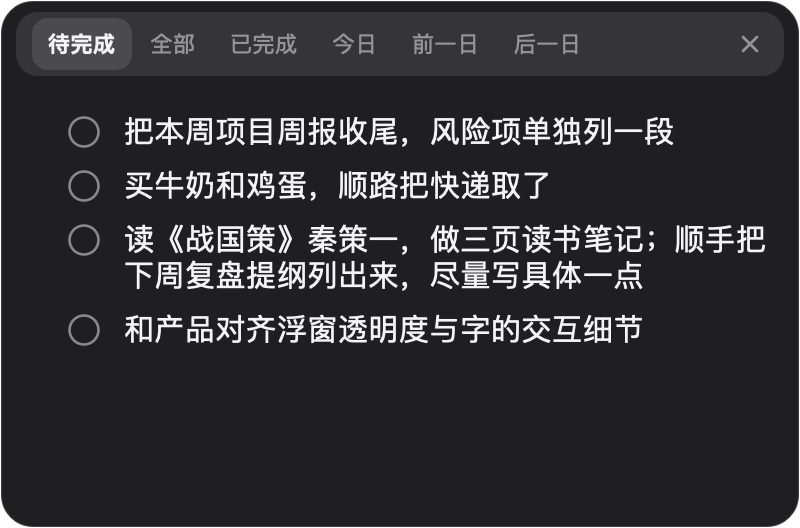

# mac-desk-todo（速签）

一个 macOS 菜单栏上的快速便签：按下 `⌥⌘N` 唤出无边框浮窗，点到哪行改哪行，写完回车直接进下一条，关闭就回菜单栏。

不为管理待办，只为让「记下一句话」这件事变便宜。纯本地、零网络、不登录，数据留在自己的磁盘上。



## 为什么需要它

要记的东西大多很碎：一句 TODO、一个想查的词、明天带把伞。它们不值得被「管理」，但打开备忘录要切 App、打开待办软件要等加载、写在便利贴上又挡代码。

真正的成本不在记，在**开始记**那一下。这个工具把这条路径压到一次快捷键：呼出即输入，光标已经在下一条等着。

## 核心能力

| 能力 | 说明 |
|---|---|
| 一键呼出 | `⌥⌘N` 呼出/收起浮窗；关闭最小化到菜单栏，左键点菜单栏图标也可切换 |
| 行内编辑 | 点行内任意位置进入编辑；`Enter` 提交并直接起下一条；空白处单击即新建 |
| 打勾交互 | 空心圆 → 实心圆 + 对钩 + 删除线；鼠标停在圆圈上弹出创建时间气泡 |
| 六种视图 | 待完成 / 全部 / 已完成 / 今日 / 前一日 / 后一日，默认「今日」并记住选择 |
| 可调外观 | 主题跟随系统（默认）/ 浅色 / 深色；10 个预设底色 + 圆盘自选；字号 12–30 实时样例；透明度 0.30–1.00 |
| 窗口归你 | 位置与尺寸持久化；无边框窗口贴边 7pt 可拖拽缩放；置顶开关默认关闭 |
| 实时保存 | 编辑即落盘，0.18s 合并写；结束编辑与退出强制刷盘；SQLite（WAL）单行增量写 |
| 开机自启 | 默认开启，登录项写入 `~/Library/LaunchAgents/com.pliddo.deskTodo.plist`，路径自校准 |
| 可自检 | `--selfcheck` 跑数据层与交互层断言，`--snapshot` 离屏渲染界面截图，两者都进回归门禁 |

## 环境要求

- macOS 12 及以上
- CommandLineTools（提供 `swiftc`），**不需要 Xcode 工程**
- 无第三方依赖、无运行时框架

## 快速上手

```bash
git clone https://github.com/mysoloai/mac-desk-todo.git
cd mac-desk-todo

bash scripts/build.sh     # 产出 build/DeskTodo.app（ad-hoc 签名）
bash scripts/run.sh       # 先退出旧实例，再整包替换并启动
```

首次启动后：

1. 菜单栏出现图标，按 `⌥⌘N` 呼出浮窗；
2. 浮窗空白处单击新建一条，输入后按 `Return` 进入下一条；
3. 右键菜单栏图标 →「设置」，调主题、底色、字号、透明度与开机自启。

## 自检与回归

```bash
build/DeskTodo.app/Contents/MacOS/DeskTodo --selfcheck           # 数据层 + 交互层断言，退出码即结果
build/DeskTodo.app/Contents/MacOS/DeskTodo --snapshot /tmp/dtd  # 离屏渲染 panel.png / settings.png
bash scripts/regression.sh                                      # 构建 + 自检 + 快照 + diff 检查
```

## 数据与隐私

- 待办：`~/Library/Application Support/DeskTodo/todos.sqlite`（WAL；旧版 `todos.json` 首启自动迁移并改名 `*.legacy.bak`）
- 偏好（颜色/字号/透明度/上次 tab/窗口位置）：`defaults` 域 `com.pliddo.deskTodo`
- 全程不联网、不上传、不收集埋点；卸载后只剩上述两处本地文件

## 目录结构

```
src/
  main.swift                 入口
  AppDelegate.swift          生命周期、菜单栏、单实例
  HotKeyManager.swift        Carbon 全局热键 ⌥⌘N
  TodoStore.swift            条目模型与合并写
  AppSettings.swift          主题/颜色/字号/透明度/窗口 frame
  Panel/                     浮窗、画布、顶部浮层、日期气泡、边缘缩放
  Settings/                  设置页
  Storage/TodoDatabase.swift SQLite（WAL）读写
  Support/                   自检、离屏快照、登录项、单实例
Resources/                   Info.plist、AppIcon.icns
scripts/                     build / run / regression / make-icon
docs/                        架构、方案、UI 规范、踩坑复盘、维护手册
```

## 文档

- 架构与数据流：[docs/architecture/app-shell.md](docs/architecture/app-shell.md)
- 方案对比与关键决策：[docs/design/app-v1-proposal.md](docs/design/app-v1-proposal.md)
- 浮窗视觉与交互规范：[docs/ui/floating-panel.md](docs/ui/floating-panel.md)
- AppKit 踩坑复盘：[docs/lessons/appkit-panel-pitfalls.md](docs/lessons/appkit-panel-pitfalls.md)
- 使用与维护手册：[docs/operations.md](docs/operations.md)

## 已知限制

- 仅 macOS，且只做本地单机：不做云同步、账号、提醒、重复任务（v1 明确的非目标）。
- 无边框窗口的边缘缩放任凭自建 `ResizeEdgeView` 接管，极端缩放设置下热区可能偏差 1–2pt。
- ad-hoc 签名包做原地覆盖安装会被系统签名缓存杀掉，请始终整包替换（`scripts/run.sh` 已处理）。

## 参与贡献

Issue / PR 都欢迎。提交前请跑 `bash scripts/regression.sh`，并保持改动聚焦：一个 PR 一件事。涉及交互细节的改动，附上 `--snapshot` 前后对比图最有效。

## License

[MIT](LICENSE) © 2026 mac-desk-todo contributors
